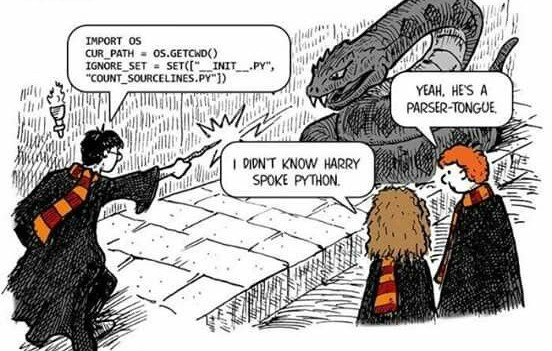

 

  

  

 

## 🧑‍💻 A Brief Info

**Hey, I'm Krishiv Purohit! - a Computer Science undergrad.** A curious mind exploring the worlds of code, robotics, and AI. Always learning, experimenting, and finding new ways to bring ideas to life.

- 🌱 **Learning:** Hardware-software integration, embedded systems, and robotics.
- 🛠️ **Building:** Experimenting with robotics, AR/VR applications, and turning random ideas into working prototypes.
- 🔭 **Exploring:** Automation, computer vision, emerging technologies, and new ways to solve real-world problems.
- 🎲 **Fun Fact:** I like solving problems, including the ones I create myself.

 

## ⚙️ Tech Stack & Tools

 

| Area | Skills |
| --- | --- |
| Programming Languages | C++ · Python |
| Robotics & Embedded Systems | ROS 2 · Embedded Systems |
| Development Environment | Visual Studio Code · Git · GitHub · Linux / Ubuntu |
| Game Development & CAD | Unity · Fusion 360 · Blender |
| Web Technologies | HTML5 · CSS3 · Basics |
| Database | MySQL |
| Design & Creative Tools | Figma · Canva |
| Documentation & Typesetting | LaTeX |

 

## 📊 GitHub Stats

 

## 🌻 Beyond the Code

- 🗣️ **People Skills** - Communication · Teamwork · Conveying Ideas
- 🎨 **Creative Side** - Creativity · Design · Thinking Outside the Box
- 🧠 **Personal Growth** - Curiosity · Learning New Things · Adaptability
- 🧩 **Problem Solving** - Critical Thinking · Finding New Ways to Solve Problems
- 🎮 **Hobbies** - Gaming · Music · Movies · Wordplay

 

  

 

## 🕹️ Github Activity 

 

